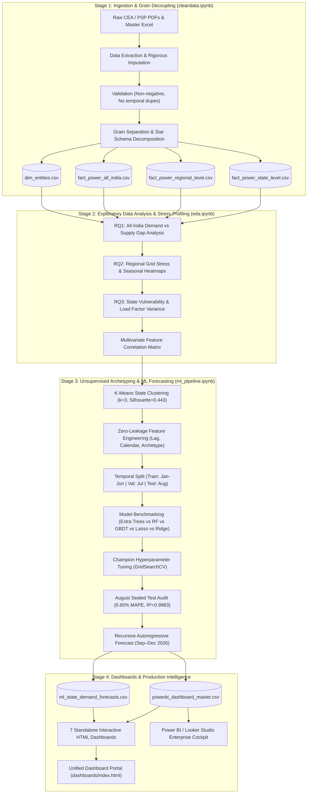

<div align="center">

# ⚡ India Energy & Power Supply Analysis & Forecasting

### *National Grid Intelligence &bull; Regional Bottleneck Profiling &bull; Demand Archetyping &bull; Recursive ML Forecasting (2026)*

[](https://www.python.org/)
[](https://scikit-learn.org/)
[](https://pandas.pydata.org/)
[](https://jupyter.org/)
[](LICENSE)

<br/>

<p align="center">
  <a href="#-interactive-dashboard-suite"><strong>Explore Dashboards</strong></a> &bull;
  <a href="#-machine-learning-architecture--performance"><strong>ML Leaderboard</strong></a> &bull;
  <a href="#-key-findings--grid-insights"><strong>Key Findings</strong></a> &bull;
  <a href="#-quickstart--reproduction"><strong>Quickstart</strong></a> &bull;
</p>

---

</div>

## 📌 Executive Summary

India's power grid represents one of the largest synchronized electrical transmission architectures in the world. As urban electrification, agricultural pumping cycles, and extreme summer heatwaves surge concurrently, predicting state-level energy demand and identifying transmission stress bottlenecks has become paramount for State Load Despatch Centres (SLDCs) and national grid planners.

This repository provides an **end-to-end data engineering, statistical profiling, and predictive machine learning pipeline** built on official **Central Electricity Authority (CEA)** and **Grid-India Power Supply Position (PSP)** records spanning all **36 States and Union Territories**, **5 macro grid regions**, and the **All-India national aggregate** for 2026.

```
       168,971 MU                 270,820 MW                   6.65% MAPE
 Highest Monthly Demand         All-India Peak Load       Extra Trees Test Accuracy
      (July 2026)                   (May 2026)                   (August 2026)
```

---

## 🚀 Key Highlights & Technical Accomplishments

- **Multi-Tier Grain Decoupling**: Solved the critical aggregate double-counting flaw prevalent in naive analyses by decomposing CEA tables into a normalized dimensional star schema (`dim_entities`, `fact_power_all_india`, `fact_power_regional_level`, `fact_power_state_level`).
- **Unsupervised Demand Archetyping**: Formulated a 4-dimensional structural demand vector per state (`log_mean_req`, `summer_surge_pct`, `seasonality_ratio`, `mean_load_factor`) and clustered 36 states via **K-Means ($k=3$, Silhouette = 0.4434)** into distinct operational archetypes.
- **Zero-Leakage Temporal ML Pipeline**: Enforced strict temporal hold-out partitioning (Train: Jan–Jun, Val: Jul, Test: Aug) preventing time-series contamination. All concurrent metrics (`energy_supplied_mu`, `peak_met_mw`, deficits) were mathematically quarantined.
- **Champion Regressor (Extra Trees)**: Achieved a held-out **6.65% MAPE**, **331.8 MU MAE**, and **$R^2 = 0.9983$** on sealed August 2026 test data, predicting **29 out of 36 states with under 10% error**.
- **Autoregressive Multi-Step Forecast**: Engineered a recursive rolling prediction loop forecasting state energy requirements across **September–December 2026**.
- **Unified Mega Intelligence Dashboard (`dashboard.html`)**: Built a single-file, zero-dependency browser cockpit with a **glassy metallic aesthetic (vibrant magenta pink, glossy silver, and fine-tuned electric blue)** that visualizes all 6 analytical dimensions with real-time state slicing and CSV data export.
- **Enterprise BI Ready**: Pre-engineered star-schema exports (`powerbi_dashboard_master.csv`) with turnkey DAX measures and Power BI report layout blueprints.

---

## 🌐 Live Dashboard

<p align="center">
  <a href="https://energy.boomurl.me/">
    
  </a>
</p>

<p align="center">
  <b>36 states and UTs. 5 grid regions. 1 interactive control room.</b><br>
  No install, no login. Open the link and start exploring.
</p>

| Try this | What you'll see |
|---|---|
| 🔌 **Executive Cockpit** | National demand for Jan–Aug 2026 (actuals) plus the Sep–Dec forecast |
| 🗺️ **State Slicer** | Pick any of the 36 states/UTs and compare actual vs forecast demand |
| 🧬 **Demand Archetypes** | See which states are summer-surge spikers and which run steady baseload |
| 🤖 **Model Audit** | Check the model leaderboard and the August 2026 test results |
| 📥 **Registry Export** | Filter the entity table and download it as CSV |

> 💡 **Tip:** open it on a laptop for the full layout. It also works on mobile.
>
> Prefer running it locally? Download [`dashboard.html`](index.html) and double-click it.


## 🏛️ Pipeline Architecture & Workflow

The pipeline executes across 4 sequential stages, guaranteeing auditable lineage from raw PDF monthly reports to production BI exports:



---

## 📊 Key Findings & Grid Insights

### 1. National Demand & Peak Load Trajectory (RQ1)
- **Summer Peak Window**: India's national peak electrical load struck **270,832 MW in May 2026**, met nearly instantaneously at **270,820 MW** (a microscopic 12 MW peak deficit), proving national transmission interconnections held under extreme pressure.
- **Energy Demand Acceleration**: Gross monthly energy requirement expanded from **141,522 MU in January** to **168,971 MU in July** and **168,032 MU in August 2026**.
- **Deficit Dynamics**: Absolute energy shortfall grew after March (rising from 28–67 MU/month in Q1 to **300 MU in May** and **203 MU in August**), demonstrating that seasonal heatwaves trigger minor supply throttling even when peak MW capacity is maintained.

### 2. Regional Grid Disparities (RQ2)
- **Demand Dominance**: Northern and Western Regions account for over **62% of India's aggregate power requirement**.
- **Seasonal Surge Asymmetry**: The **Northern Region** exhibits the most volatile demand spike (+42% summer increase), propelled by intense domestic cooling and paddy irrigation loads across Uttar Pradesh, Punjab, and Haryana.
- **Grid Utilization**: The **Western Region** maintained the steadiest industrial base-load utilization (~78–82% Load Factor), while the **North-Eastern Region** displayed the widest load factor variance (51–74%).

### 3. State-Level Demand Archetypes (RQ3)
Using K-Means clustering on normalized state profiles (`k=3`, Silhouette Score = 0.4434), the 36 States/UTs naturally partitioned into three distinct structural regimes:

| Archetype Cluster | State Count | Avg Monthly Demand | Summer Surge | Avg Load Factor | Typical States | Operational Implication |
|---|---|---|---|---|---|---|
| **0: Steady Baseload Grid** | 21 | 5,446.9 MU | +8.5% | 77.9% | Maharashtra, Gujarat, Tamil Nadu, Karnataka, Chhattisgarh | Predictable baseload demand; industrial corridors; thermal base scheduling. |
| **1: Summer Heatwave Surge Spikers** | 8 | 4,287.3 MU | **+42.0%** | 67.5% | Uttar Pradesh, Punjab, Haryana, Delhi, Bihar, Assam | Extreme cooling & agricultural volatility; requires aggressive spot power procurement. |
| **2: Low-Volume Enclaves** | 7 | 82.9 MU | -1.9% | 62.2% | Arunachal, Lakshadweep, Mizoram, Nagaland, Sikkim | Low consumption volume; non-summer winter heating peaks; localized micro-grids. |

---

## 🤖 Machine Learning Architecture & Performance

### 1. Zero-Leakage Feature Engineering
To prevent data snooping and target leakage, candidate features were audited under strict time-causality principles:

| Feature Name | Category | Safe / Excluded | Justification |
|---|---|---|---|
| `log_lag_1_req` | Autoregressive Lag | ✅ **Safe** | Preceding month's actual demand; known before target month begins. |
| `log_mean_req` | Historical Scale | ✅ **Safe** | Static state baseline volume scale computed over training period. |
| `days_in_month` | Calendar Signal | ✅ **Safe** | Deterministic calendar length (28–31 days). |
| `month`, `fy_month_index` | Seasonality Index | ✅ **Safe** | Deterministic calendar position. |
| `is_summer` | Climate Flag | ✅ **Safe** | Binary indicator (1 for April–July summer window). |
| `rgn_*` | Spatial Vector | ✅ **Safe** | One-hot encoded macro grid region. |
| `clust_*` | Regime Vector | ✅ **Safe** | One-hot encoded K-Means structural demand cluster. |
| `energy_supplied_mu`, `peak_met_mw` | Dispatch Metric | ❌ **Strictly Excluded** | Only observable **after** the target month concludes. |
| Deficit Percentages | Arithmetic Derivative | ❌ **Strictly Excluded** | Algebraic functions of target requirement and supply. |

### 2. Validation Set Leaderboard (July 2026 Hold-Out)
Candidate models were trained on Months 1–6 (January–June 2026, 216 rows) and evaluated on Month 7 (July 2026, 36 rows):

| Model Rank | Regressor | Val MAPE (%) | Val MAE (MU) | Val RMSE (MU) | Log $R^2$ |
|:---:|---|:---:|:---:|:---:|:---:|
| 🥇 | **Extra Trees Regressor** | **5.99%** | **385.7** | **805.8** | **0.9986** |
| 🥈 | Gradient Boosting Regressor | 6.54% | 401.4 | 834.4 | 0.9985 |
| 🥉 | Random Forest Regressor | 7.32% | 416.7 | 867.6 | 0.9982 |
| 4 | Lasso Regression (L1) | 8.87% | 418.2 | 883.1 | 0.9976 |
| 5 | Ridge Regression (L2) | 10.41% | 467.2 | 886.9 | 0.9967 |
| 6 | K-Nearest Neighbors (KNN) | 60.35% | 1698.5 | 2810.1 | 0.9156 |

### 3. Champion Model & August 2026 Test Evaluation
The champion **Extra Trees Regressor** was tuned via 5-fold cross-validation (`n_estimators=200`, `max_depth=8`, `min_samples_split=2`), retrained on Jan–Jul, and evaluated on the **completely sealed August 2026 test set (36 states)**:

```
============================================================
  AUGUST 2026 TEST RESULTS: Extra Trees Regressor
============================================================
  Mean Absolute Percentage Error (MAPE) : 6.65%
  Mean Absolute Error (MAE)            : 331.8 MU
  Root Mean Squared Error (RMSE)       : 577.6 MU
  Coefficient of Determination (R²)    : 0.9983
============================================================
  State Accuracy Distribution:
  - States with < 5% forecast error    : 15 / 36 (41.7%)
  - States with < 10% forecast error   : 29 / 36 (80.5%)
  - Maximum observed error             : 18.1% (Punjab agricultural peak)
============================================================
```

### 4. Top Feature Importances
1. **`log_mean_req` (41.84%)**: Baseline state consumption scale.
2. **`log_lag_1_req` (39.87%)**: Autoregressive momentum from prior month.
3. **`clust_2` (16.21%)**: Structural indicator for low-volume island/hill enclaves.
4. **`rgn_SR` (0.96%)**: Southern Region spatial shift.
5. **`rgn_ER` (0.48%)**: Eastern Region spatial shift.

### 5. Recursive Out-of-Sample Forecast (September–December 2026)
Using the tuned autoregressive model, demand was projected across the final four months of 2026:

| Month | Projected All-India Demand | Average State Demand | Maximum State Forecast | Minimum State Forecast |
|---|---|---|---|---|
| **September 2026** | **156,830.7 MU** | 4,356.4 MU | 17,036.6 MU (Maharashtra) | 6.1 MU (Lakshadweep) |
| **October 2026** | **155,035.6 MU** | 4,306.5 MU | 17,744.6 MU (Maharashtra) | 6.1 MU (Lakshadweep) |
| **November 2026** | **150,591.9 MU** | 4,183.1 MU | 17,495.4 MU (Maharashtra) | 6.1 MU (Lakshadweep) |
| **December 2026** | **150,124.4 MU** | 4,170.1 MU | 17,558.4 MU (Maharashtra) | 6.1 MU (Lakshadweep) |

---

## ⚡ The Mega Intelligence Dashboard (`dashboard.html`)

For instant visual exploration of the entire research study, the repository includes a unified, client-side **Mega Intelligence Dashboard** ([`Dashboard`](index.html)).

### Aesthetic & Design Philosophy
Engineered to deliver an ultra-premium executive and control-room experience:
- **Glassy Metallic Material System**: Translucent frosted glass containers (`backdrop-filter: blur(20px)`), crisp specular borders, and ambient neon reflections over a deep carbon obsidian canvas.
- **Curated Metallic Colorway**:
  - 💖 **Vibrant Magenta Pink** (`#ff2a8d`): Spotlights peak electrical loads, summer heatwave surges, and forecast trajectories.
  - 🪙 **Glossy Silver / Platinum** (`#e2e8f0`): Refined brushed metallic borders, high-contrast KPI labels, and specular badge trims.
  - 💎 **Fine-Tuned Electric Blue** (`#0ea5e9`): Anchors baseline energy actuals, baseload archetypes, and power met metrics into a balanced, futuristic command center.

### 6 Unified Analytical Panes in One View
1. **Executive Cockpit**: Dual-timeline national monthly trajectory (Actuals Jan–Aug + ML Forecasts Sep–Dec), regional demand share donut, peak megawatts capacity vs met, and unserved energy shortfall bars.
2. **Regional Grids (5 Pools)**: Comparative monthly curves across Northern, Western, Southern, Eastern, and North-Eastern pools, load factor dynamics, and regional deficit concentrations.
3. **State Slicer & Explorer**: Live interactive dropdown to slice any of the **36 States/UTs** with immediate timeline rendering, actual vs forecast totals, Top-10 consumption rankings, and shortfall severity percentages.
4. **Demand Archetypes (K-Means)**: Detailed structural cards for all 3 clusters with constituent state chips, plus an interactive 2D scatter plot (**Summer Surge % vs Mean Load Factor %**).
5. **Machine Learning Pipeline & Model Audit**: Regressor benchmark leaderboard (Extra Trees, GBDT, Random Forest, Lasso, Ridge, KNN), champion feature importance weights, and August 2026 test evaluation error bars.
6. **Master Entity Registry**: Comprehensive searchable, filterable table with real-time text search, regional filters, and a **client-side CSV export button**.

> **Zero Dependencies**: `dashboard.html` has zero backend, database, or server dependencies. Simply double-click the file to launch it in any modern browser!

---

## 📁 Repository Structure

```plaintext
energy-supply-and-analysis/
│
├── .gitignore                          # Comprehensive ignore rules for Python, Jupyter & VS Code
├── requirements.txt                    # Pinned Python package dependencies (pip)
├── environment.yml                     # Conda virtual environment definition
├── LICENSE                             # MIT Open-Source License
├── README.md                           # Master repository documentation (this file)
│
├── Energy and Peak DATA.xlsx           # Consolidated raw spreadsheet of CEA/PSP reports
├── pdf_data_source.zip                 # Compressed archive of official monthly PDF reports
│
├── cleandata.ipynb                     # Stage 1: Data extraction, cleaning, grain separation & validation
├── eda.ipynb                           # Stage 2: Exploratory data analysis, RQ1-RQ3, heatmaps, correlations
├── ml_pipeline.ipynb                   # Stage 3: K-Means archetyping, zero-leakage ML pipeline, recursive forecasts
│
└── data/
    ├── README.md                       # Data dictionary, grain separation rules & column catalog
    └── processed/
        ├── dim_entities.csv            # Dimension table: 47 entities (States, UTs, Regions, National)
        ├── fact_power_all_india.csv    # Fact table: All-India monthly power metrics (Jan-Aug 2026)
        ├── fact_power_regional_level.csv # Fact table: 5 macro grid regions x 8 months
        ├── fact_power_state_level.csv  # Fact table: 36 States/UTs x 8 months
        ├── ml_state_demand_archetypes.csv # 36-state K-Means clusters and structural profiles
        ├── ml_state_demand_forecasts.csv  # August test predictions + Sep-Dec forecasts
        └── powerbi_dashboard_master.csv   # Denormalized master table for Power BI / Looker Studio
│
└── index.html                      # ⚡ Unified Mega Intelligence Dashboard (Glassy Metallic)
```

---

## ⚡ Quickstart & Reproduction Guide

### 1.Clone the Repository
```
### 1. Clone the Repository
```bash
git clone https://github.com/ossaui/energy-supply-and-analysis.git
cd energy-supply-and-analysis
```

### 2. Environment Setup

#### Using `pip`:
```bash
# Create a virtual environment
python -m venv .venv

# Activate environment
# On Windows:
.venv\Scripts\activate
# On Linux / macOS:
source .venv/bin/activate

# Install dependencies
pip install -r requirements.txt
```

#### Using `conda`:
```bash
conda env create -f environment.yml
conda activate energy-power-analysis
```

### 3. Run Pipeline Notebooks
Execute the notebooks in sequence:
```bash
jupyter lab
```
1. Open and run [`cleandata.ipynb`](cleandata.ipynb) &mdash; ingests raw sheets, cleans data, validates constraints, and generates star schema CSVs.
2. Open and run [`eda.ipynb`](eda.ipynb) &mdash; explores national trends, regional bottlenecks, and state vulnerabilities.
3. Open and run [`ml_pipeline.ipynb`](ml_pipeline.ipynb) &mdash; clusters demand archetypes, trains champion regressors, runs the recursive forecast loop, and exports BI tables.

---

## 📖 Metric Reference & Glossary

| Metric Symbol | Full Name | Standard Unit | Mathematical Formulation / Definition |
|:---:|---|:---:|---|
| **MU** | Million Units | $10^6\text{ kWh} = 1\text{ GWh}$ | Gross electrical energy consumption or generation over a month. |
| **MW** | Megawatts | $10^3\text{ kW}$ | Instantaneous power demand or generation capacity rate. |
| **LF** | Load Factor | Percentage ($\%$) | $\frac{\text{Energy Requirement (MU)} \times 10^3}{\text{Peak Demand (MW)} \times \text{Days in Month} \times 24} \times 100$ |
| **ENS** | Energy Not Supplied | MU | $\text{Energy Requirement (MU)} - \text{Energy Supplied (MU)}$ |
| **DNM** | Demand Not Met | MW | $\text{Peak Demand (MW)} - \text{Peak Met (MW)}$ |
| **MAPE** | Mean Absolute % Error | Percentage ($\%$) | $\frac{1}{n} \sum_{i=1}^{n} \left\| \frac{y_i - \hat{y}_i}{y_i} \right\| \times 100$ |

---

## 👤 Author & Acknowledgments
- **Author & Researcher**: **Ambar Gurav** ([@ossaui](https://github.com/ossaui))
- **Data Source**: Central Electricity Authority (CEA), Ministry of Power, Government of India & Grid Controller of India Limited (Grid-India).

## 📄 License
This project is licensed under the [MIT License](LICENSE) &mdash; feel free to use, modify, and build upon this research.
