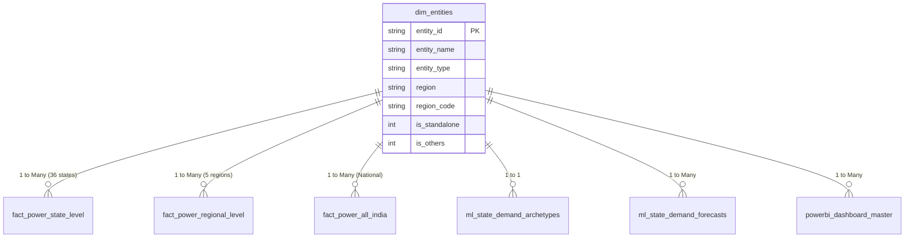

# Data Architecture & Dimensional Catalog

This directory houses the processed datasets, dimensional star-schema tables, and production exports for the **India Energy & Power Supply Analysis** project.

---

## 1. Dimensional Architecture & Grain Separation

A foundational contribution of this project is strict **grain separation** (implemented in [`cleandata.ipynb`](../cleandata.ipynb)). In raw source reports from the Central Electricity Authority (CEA) and Grid-India, national aggregates, regional aggregates, and state-level observations are co-located in identical tables. Treating these as a single flat table leads to severe double-counting (summing national totals with constituent states quadruples actual demand).

Our pipeline decomposes the raw records into a normalized dimensional structure:

---

## 2. Processed Files Catalog

All files reside in `data/processed/`:

### 2.1 Core Star Schema Tables

| File Name | Grain / Entity Level | Rows | Columns | Purpose |
|---|---|---|---|---|
| [`dim_entities.csv`](./processed/dim_entities.csv) | Entity Dimension | 47 | 8 | Master registry of all 47 entities (36 states/UTs, 5 regions, All-India, DVC, Others). |
| [`fact_power_all_india.csv`](./processed/fact_power_all_india.csv) | National &times; Month | 8 | 27 | Macro national time-series (Jan–Aug 2026): aggregate energy, peak demand, deficit, and load factor. |
| [`fact_power_regional_level.csv`](./processed/fact_power_regional_level.csv) | Region &times; Month | 40 | 27 | 5 macro-regions (Northern, Western, Southern, Eastern, North-Eastern) &times; 8 months. |
| [`fact_power_state_level.csv`](./processed/fact_power_state_level.csv) | State/UT &times; Month | 288 | 27 | Granular state/UT level time-series (36 states &times; 8 months). Used as training ground for ML. |

### 2.2 Machine Learning & Production Exports

| File Name | Grain | Rows | Columns | Purpose |
|---|---|---|---|---|
| [`ml_state_demand_archetypes.csv`](./processed/ml_state_demand_archetypes.csv) | State (Static) | 36 | 7 | 36-state structural profiles with K-Means cluster assignment and human-readable archetype names. |
| [`ml_state_demand_forecasts.csv`](./processed/ml_state_demand_forecasts.csv) | State &times; Month | 180 | 8 | August 2026 held-out test predictions (36 rows) + September–December 2026 recursive out-of-sample forecasts (144 rows). |
| [`powerbi_dashboard_master.csv`](./processed/powerbi_dashboard_master.csv) | State &times; Month | 432 | 11 | Denormalized master table (36 states &times; 12 months: Jan–Aug actuals + Sep–Dec forecasts) with `data_type` discriminator. |

---

## 3. Data Dictionary (Metric Definitions & Units)

| Column Name | Type | Unit | Description |
|---|---|---|---|
| `month_start` | Date | `YYYY-MM-DD` | Start date of the reporting month (e.g. `2026-01-01`). |
| `fy` | String | Categorical | Indian Financial Year designation (`FY2025-26` for Jan–Mar, `FY2026-27` for Apr–Aug). |
| `fy_month_index` | Integer | Index (1–12) | Financial year month index (`1` = April, ..., `12` = March). |
| `days_in_month` | Integer | Days | Calendar day count for the month (28–31). |
| `entity_name` | String | Categorical | Canonical entity name (e.g., `Maharashtra`, `Uttar Pradesh`). |
| `region` | String | Categorical | One of 5 macro grid regions: `Northern Region`, `Western Region`, `Southern Region`, `Eastern Region`, `North-Eastern Region`. |
| `energy_requirement_mu` | Float | **MU** (Million Units) | Gross electrical energy demand during the month ($1\text{ MU} = 10^6\text{ kWh} = 1\text{ GWh}$). |
| `energy_supplied_mu` | Float | **MU** (Million Units) | Electrical energy dispatched and supplied to consumers. |
| `energy_not_supplied_mu` | Float | **MU** (Million Units) | Unserved electrical energy demand ($\text{Requirement} - \text{Supplied}$). |
| `energy_ns_pct` | Float | **%** | Percentage of energy demand unserved ($(\text{Energy Not Supplied} / \text{Requirement}) \times 100$). |
| `peak_demand_mw` | Float | **MW** (Megawatts) | Instantaneous peak power demand recorded during the month ($1\text{ MW} = 10^3\text{ kW}$). |
| `peak_met_mw` | Float | **MW** (Megawatts) | Maximum peak power capacity met by generating assets during the peak window. |
| `demand_not_met_mw` | Float | **MW** (Megawatts) | Peak capacity shortfall ($\text{Peak Demand} - \text{Peak Met}$). |
| `demand_nm_pct` | Float | **%** | Percentage of peak power demand not met. |
| `load_factor_pct` | Float | **%** | Ratio of average power to peak power: $\frac{\text{Energy Requirement (MU)} \times 10^3}{\text{Peak Demand (MW)} \times \text{Days} \times 24} \times 100$. |
| `data_type` | String | Flag | `'Actual'` for historical observations (Jan–Aug 2026), `'Forecast'` for future projections (Sep–Dec 2026). |
| `archetype_name` | String | Categorical | Behavioral cluster classification assigned by K-Means model. |

---

## 4. Primary Data Sources
- **Source Reports:** Central Electricity Authority (CEA) of India, Ministry of Power.
- **Archive:** Raw regulatory PDF reports preserved in [`pdf_data_source.zip`](../pdf_data_source.zip); consolidated master raw spreadsheet preserved in [`Energy and Peak DATA.xlsx`](../Energy%20and%20Peak%20DATA.xlsx).
